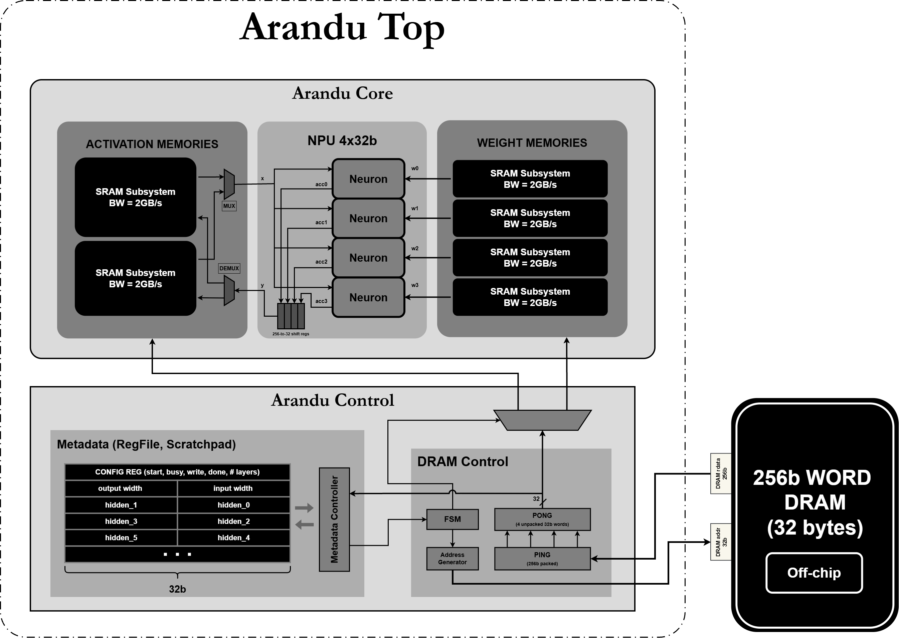

# Arandu
## A Naive DNN Accelerator using Latency Hiding

This project is not an attempt to inovate the well-established DNN hardware architecture fiel. It is just a personal project I made concurrently with my studies, including loop nesting, data reuse, etc. and trying to use minimal digital resources like flip-flops and combinational logic.

One of the key ideas in the SRAM susbsystem, which contains a little secret technique to generate a 2GB/s bandwidth (around 80% of efficiency). The weights and the activations are stored in these on-chip memories.

